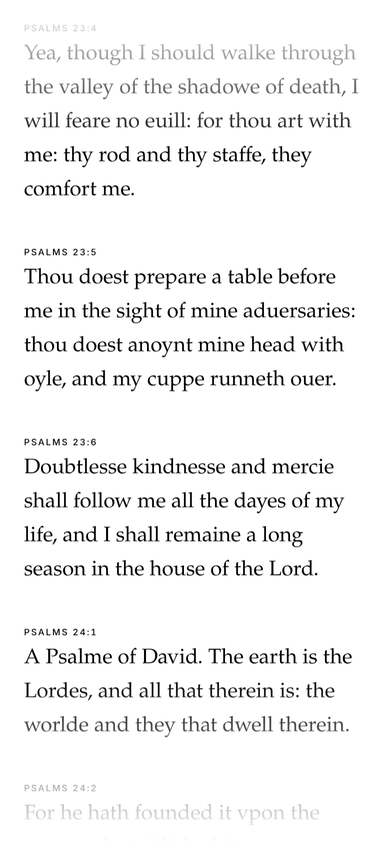
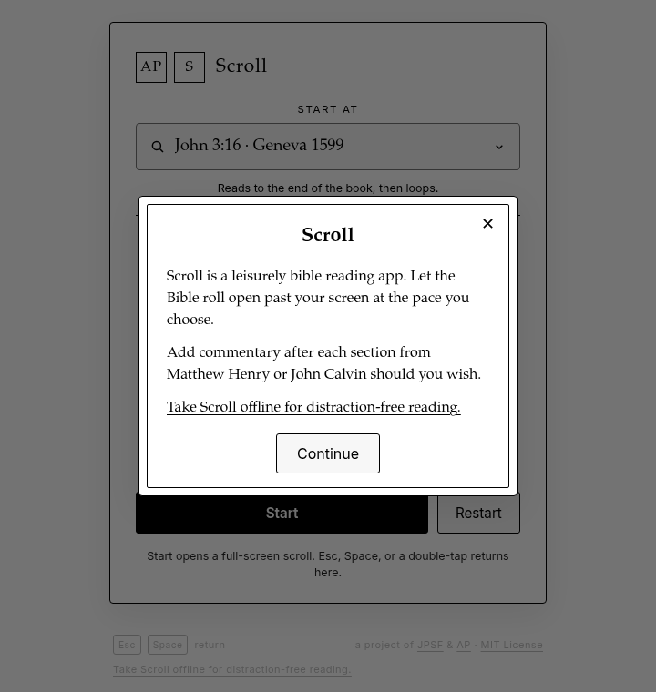
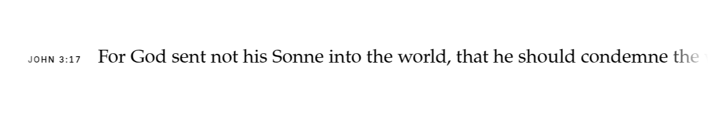
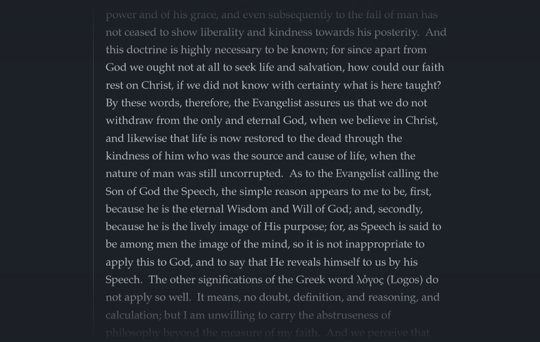

<div align="center">

# Scroll

**Scroll is a leisurely bible reading app.**
Let the Bible roll open past your screen at the pace you choose.

[**Try it online**](https://apocalypse.press/scroll/) · [**Download for offline use**](https://github.com/elcafe7/bible_scroller/releases/download/v0.1.0/bible_scroller-0.1.0.zip) · [Word](https://apocalypse.press/word/) · [Verse](https://apocalypse.press/verse/)

[](LICENSE)
[](https://scorecard.dev/viewer/?uri=github.com/elcafe7/bible_scroller)

<sub>A project of <a href="https://jesuspeoplesf.com">Jesus People SF</a> &amp; <a href="https://apocalypse.press">Apocalypse Press</a></sub>



</div>

---

## What it does

- **Three Bibles:** Geneva Bible (1599), King James Version (1611 original), and King James Version (Oxford 1769). The Geneva and 1611 editions include the Apocrypha.
- **Commentary if you want it:** Matthew Henry or John Calvin, shown after each section of verses it covers.
- **Two ways to read:** a slow vertical scroll, or a one-line ticker across the screen.
- **Your pace:** Very Slow, Slow, Medium, or Fast; four text sizes; light or dark.
- **Starts anywhere:** pick a book, chapter, and verse. It reads to the end of the book, then loops.
- **Stays awake:** the screen stays on while it scrolls (where the browser allows it).

<p align="center">
  
</p>

<p align="center">
  
</p>

<p align="center">
  
</p>

## Download for offline use

**[bible_scroller-0.1.0.zip](https://github.com/elcafe7/bible_scroller/releases/download/v0.1.0/bible_scroller-0.1.0.zip)** (~24.5 MB) · [SHA256SUMS](https://github.com/elcafe7/bible_scroller/releases/download/v0.1.0/SHA256SUMS) · [release page](https://github.com/elcafe7/bible_scroller/releases/tag/v0.1.0)

It is just files: HTML, CSS, JavaScript, and the Bible and commentary text. Nothing to install, no account, no internet once downloaded.

1. Unzip it. You get one `bible_scroller` folder.
2. Open `bible_scroller/index.html` by double-clicking it.

That's it. Keep `index.html` next to its `assets` and `data` folders. Settings are saved in your browser only.

Or skip the download and read online at **[apocalypse.press/scroll](https://apocalypse.press/scroll/)**.

## Verification

Releases built by [`.github/workflows/release.yml`](.github/workflows/release.yml)
are built, scanned, checksummed and attested by GitHub Actions. Each such
release on the [Releases page](https://github.com/elcafe7/bible_scroller/releases) has, next
to the downloads:

| File | What it is |
|---|---|
| `SHA256SUMS` | SHA-256 checksums for every file in the release |
| `<name>.cdx.json` | CycloneDX SBOM (software bill of materials) |
| `<name>-osv-scan.json` / `.md` | Dated OSV-Scanner report |
| `verification.json` | Scan summary (tool, date, result, report link) for download pages |

A release is only published when every check passes: OSV-Scanner finds no
known vulnerabilities (CVSS 7.0 or higher fails the release, and lower-rated
findings hold it too; advisories with no CVSS score are listed as warnings),
the checksums verify, and VirusTotal (when turned on) flags nothing. If any
check fails, nothing is published, and the findings with a suggested fix go
to a "Release blocked" issue instead. Details:
[docs/RELEASE_VERIFICATION.md](docs/RELEASE_VERIFICATION.md).

**Check the checksums** (download the files plus `SHA256SUMS` into one folder):

```bash
sha256sum -c --ignore-missing SHA256SUMS        # Linux
shasum -a 256 -c --ignore-missing SHA256SUMS    # macOS
```

**Check build provenance** with the [GitHub CLI](https://cli.github.com/).
This confirms the file was built from this repository by GitHub Actions:

```bash
gh attestation verify bible_scroller-<version>.zip -R elcafe7/bible_scroller
```

**Re-scan against today's advisories** (the report is a dated record):

```bash
osv-scanner scan source -L bible_scroller-<version>.cdx.json
```

Releases published before the workflow existed have only `SHA256SUMS`.

## Controls

| Action | How |
|---|---|
| Start, or resume where you stopped | **Start** / **Resume** |
| Back to settings (pauses) | **Esc**, **Space**, or double-tap the text |
| Start the passage over | **Restart** |
| Choose a passage | Tap the passage box, then edition, book, chapter, verse (or type "John 3:16") |

## Texts

Bible text: Geneva Bible (1599), King James Version (1611 original, with Apocrypha), King James Version (Oxford 1769). Commentary: Matthew Henry, John Calvin. All public domain.

## License

App code is under the [MIT License](LICENSE), Copyright (c) 2026 elcafe7.

---

<details>
<summary><b>Build from source</b> (only to change the app; not needed to use it)</summary>

The app is TypeScript compiled to one plain JavaScript file. Authors rebuilding it need Node 22.13+ for the Vite build and the data export; readers never do.

```bash
npm install
npm run build-data   # Lex SQLite (read-only) -> data/**/*.json; needs the Lex databases on this machine
npm run build        # tsc --noEmit + Vite -> dist/
npm test             # vitest
npm run pack         # -> bible_scroller-<version>.zip (data as data/**/*.json.js so it opens from file://)
npm run stage-web -- <out>/scroll /scroll/   # web copy (data as .json) + .htaccess for apocalypse.press/scroll/
```

- `data/` is generated and git-ignored; without it builds use the John 1 fixture. No `.db` files are ever committed or packed.
- Online, the app fetches `data/**/*.json`. Offline, each file ships as a small `.json.js` script so the page works when opened straight from disk in every browser.
- Spec: [`docs/specs/bible-scroller.md`](docs/specs/bible-scroller.md).

</details>
